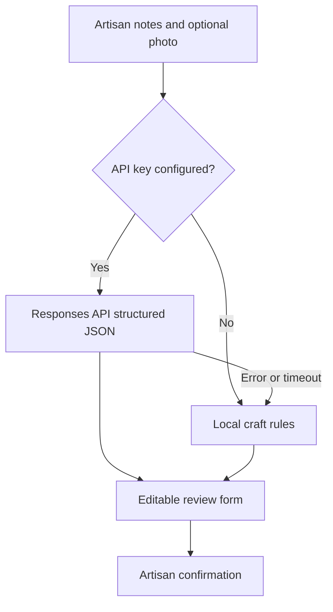

# AI and decision logic

| Capability | Current method | Why |
| --- | --- | --- |
| Catalogue creation | OpenAI vision/text Structured Output when configured; local keyword rules otherwise | Image and multilingual text can aid extraction, while no-key demos stay usable. |
| Photo studio | Browser canvas adjustment | Deterministic, private and faithful to craft texture. No false claim of generative cleanup. |
| Speech input and voice control | Browser Web Speech plus transparent command rules | Reduces typing with a typed fallback. Browser support varies. |
| Fair pricing | Deterministic cost formula | Makers can inspect every rupee; a model should not invent market prices. |
| Buyer matching | Weighted business rules | Category, capacity, budget and deadlines need inspectable constraints. |
| Demand projection | Capped trend on a three-month moving average | Enough to demonstrate the workflow without pretending synthetic sales train a reliable model. |

The optional provider receives only the description and newly uploaded image supplied for the suggestion. It uses `store: false`, a 15-second timeout and a strict JSON schema. No model output bypasses the artisan review form. The code does not claim a successful live provider test without a key. See [official vision guidance](https://developers.openai.com/api/docs/guides/images-vision) and [Structured Outputs](https://developers.openai.com/api/docs/guides/structured-outputs).

The price formula is `base = material + labourHours × labourRate + packaging + logistics + overhead`; `margin = base × marginPercent / 100`; `suggestion = round up (base + margin) to ₹10`. A market reference is displayed separately and never silently overrides the cost-based recommendation.

Demand projections come from seeded synthetic monthly counts. They are never described as live market forecasts. Connect verified sales and event data before using them for real production decisions.
