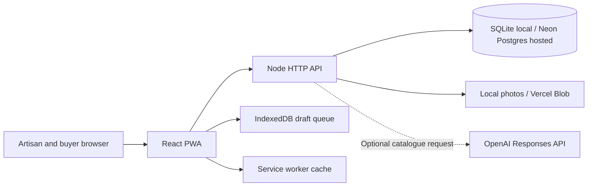
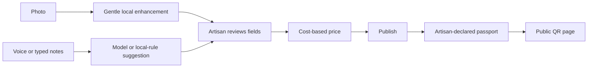
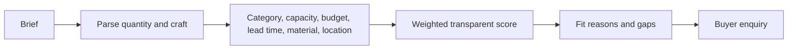

# Architecture

Development runs Vite on 5173 with an API proxy to a Node server on 3001. SQLite WAL mode and local uploads keep the app runnable on one machine. On Vercel, the built client is static, the Node API runs as a Function, and Neon Postgres and Vercel Blob keep records and photos persistent. The optional model is confined to catalogue suggestions.

## End-to-end product flow

## Roles

The API checks each action server-side. Artisans can edit only their own products and see their own orders/enquiries. Buyers can place stock-checked orders, save briefs and send enquiries. Admins can inspect platform activity and mark a passport record reviewed. Public users can browse published products and passports.

## Folder map

| Path | Contents |
| --- | --- |
| `src/` | React pages, shared UI, offline queue, PWA registration |
| `server/` | HTTP API, schema, seed data, deterministic engines, optional AI adapter, tests |
| `public/images/` | Local demo craft photography |
| `public/sw.js` | Service worker cache |
| `data/` | SQLite file created at runtime |
| `uploads/` | Validated artisan photos created at runtime |
| `docs/` | Product and engineering documentation |

## Buyer matching

Scores guide discovery; the maker and buyer confirm actual availability and terms directly.
