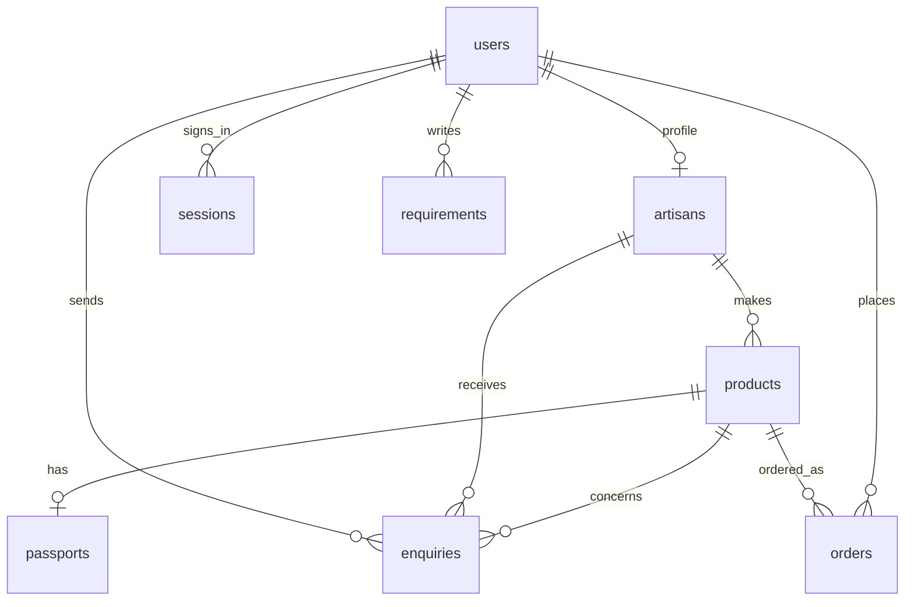

# Database schema

SQLite migrations are in `server/schema.sql`; the equivalent Postgres schema is in `server/schema.pg.sql`. `npm run db:migrate` is idempotent and uses the selected database. Local SQLite uses WAL and foreign keys.

| Table | Purpose and key rules |
| --- | --- |
| `users`, `sessions` | Unique email, scrypt password hash, hashed session token and expiry. |
| `artisans` | Craft, region, story, capacity, lead time and customisation fields. |
| `products` | Editable listing; `client_id` prevents duplicate offline creates, `version` detects stale edits. |
| `passports` | One public record per published product; artisan-declared or platform-reviewed. |
| `requirements` | Buyer bulk brief and structured constraints. |
| `enquiries` | Buyer message to an artisan about a product or brief. |
| `orders` | One product per order, captured unit price and stock-checked quantity. |
| `sales_history` | Synthetic category/month units for demo projections. |

Amounts are integer INR for this demo. Before multi-currency or detailed tax handling, migrate to minor-unit money fields and explicit currency codes. Back up local `data/` and `uploads/` together, or back up the hosted database and Blob store, so photo references remain valid.
