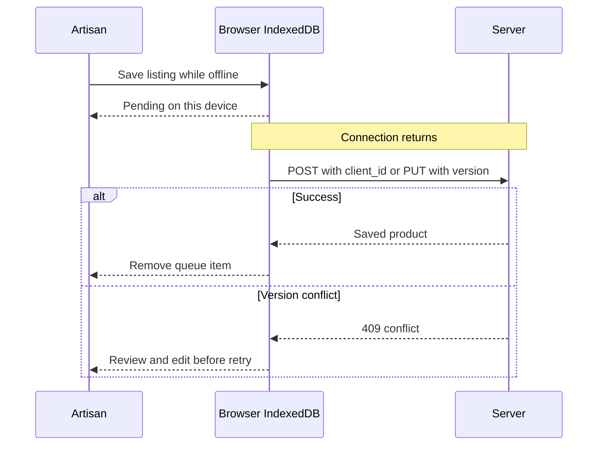

# Offline sync

The production client registers a service worker. It caches the app shell, craft images and successful public GET responses. A browser must load the site once online before the shell can reopen offline. Private account API responses are not cached.

New and edited listings are saved in IndexedDB when the browser reports offline or a network request fails. Each queue item belongs to the account that created it, and sync only processes that account's items. The queue keeps the latest local change per product. It syncs on reconnect and on signed-in app startup. The offline page shows pending, conflict and needs-attention states and allows a manual retry or local discard.

`client_id` prevents duplicate products if a create request succeeds but the response is lost. Existing product edits use optimistic `version` checks. The queue is device-local: clearing site data removes unsynced drafts. Local drafts are not encrypted, so a shared browser profile is not a private store. A production rollout should add encrypted backup, attachment resumability and a clearer field-level conflict merge. Browser speech recognition can require network; typed notes work offline.
